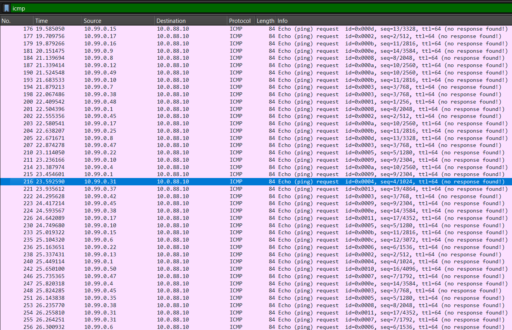
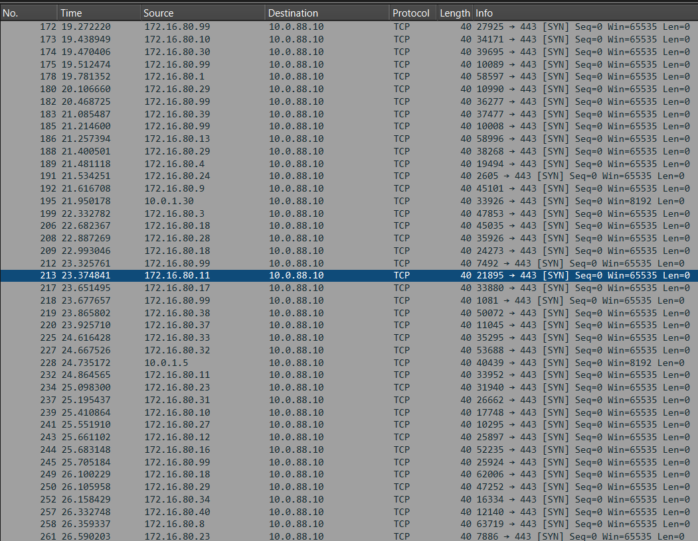
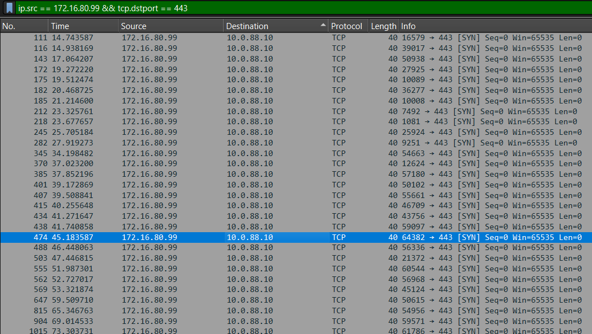

# Signal & Noise — A Forensic Investigation

**Category:** Forensics ·
**Points:** 300 
**Flag:** `FLOWTRIQ{decoy_icmp_pivot_172.16.80.99}`


## Chapter 1 — The Loudest Suspect

I opened `signal-and-noise.pcap` in Wireshark and started with the most obvious traffic.

The first filter was:

```wireshark
icmp
```

Almost immediately, the packet list filled with ICMP Echo Requests targeting:

```text
10.0.88.10
```

The statistics were impressive:

- 800 ICMP Echo Requests
- 50 different source addresses
- Sources distributed across `10.99.0.0/24`
- Traffic active for approximately 117.5 seconds

It looked like a classic distributed ping flood.

### Screenshot 1 — ICMP Flood



*Figure 1: ICMP Echo Request traffic targeting the victim server.*

This was clearly suspicious. However, the challenge was not asking which traffic looked the most malicious.

It was asking which traffic was the decoy.

I recorded the observation and continued.

---

## Chapter 2 — The Second Attack Vector

The next step was investigating TCP traffic.

HTTPS was the obvious target, so I applied the following filter:

```wireshark
ip.dst == 10.0.88.10 && tcp.dstport == 443 && tcp.flags.syn == 1
```

The packet list revealed another suspicious pattern.

Numerous hosts were repeatedly sending TCP SYN packets to port 443. The traffic resembled a SYN flood attempting to exhaust the server's connection resources.

The capture contained:

- 560 TCP SYN packets
- 44 distinct source addresses
- Destination: `10.0.88.10:443`

### Screenshot 2 — TCP SYN Flood



*Figure 2: TCP SYN requests targeting the victim's HTTPS service.*

The TCP traffic was interesting, but the source addresses alone did not reveal the attack's full structure.

I needed to find another protocol that connected the activity.

---

## Chapter 3 — A Strange DNS Pattern

I moved to DNS.

The filter was simple:

```wireshark
dns
```

Most DNS traffic was unremarkable. Then one address stood out:

```text
172.16.80.99
```

This host repeatedly sent DNS `ANY` queries for:

```text
big-record.example.org
```

I narrowed the investigation:

```wireshark
dns.qry.type == 255
```

The results showed repeated DNS ANY queries.

The pattern was unusual.

The same internal address was querying several resolvers:

```text
198.18.0.11
198.18.0.22
198.18.0.33
198.18.0.44
```

The capture contained 31 queries, followed by approximately 350 large DNS responses directed toward the victim.

This was consistent with DNS amplification.

Small requests were being used to generate significantly larger responses, increasing the traffic directed at the target.

The name `big-record.example.org` was another clue: it suggested that the queried domain contained a large record set.

The DNS traffic was no longer just suspicious.

It was a potential explanation for the attack.

---

## Chapter 4 — Following the Pivot

At this point, I had two plausible attack vectors:

- TCP SYN flooding
- DNS amplification

But the challenge described something more specific.

It wanted a single IP address that appeared in one attack vector and then reappeared orchestrating another.

I already knew the DNS queries came from:

```text
172.16.80.99
```

The next question was whether this address also appeared in the TCP traffic.

I applied:

```wireshark
ip.src == 172.16.80.99 && tcp.dstport == 443 
```

The packets appeared.

The same address participating in the TCP SYN flood was responsible for the DNS ANY queries.

### Screenshot 4 — Pivot Correlation



*Figure 4: Correlation of the same source address across TCP and DNS activity.*

This was the breakthrough.

The address `172.16.80.99` connected two different attack vectors.

The pivot had been found.

---

## Chapter 5 — Separating Signal from Noise

Now the investigation became much simpler.

The challenge required identifying the attack vector that was disconnected from the pivot.

The evidence could be summarized:

| Vector | Evidence | Pivot Connected? |
|---|---|---|
| ICMP | 800 Echo Requests from 50 sources | No |
| TCP | 560 SYN packets from 44 sources | Yes |
| DNS | 31 ANY queries from one host | Yes |

The TCP and DNS activity shared the same suspicious host.

ICMP did not.

Despite being the loudest traffic in the capture, the ICMP flood was disconnected from the correlated attack activity.

That was the answer hidden in the title.

**The noise was ICMP. The signal was the TCP-DNS relationship.**

---

## Chapter 6 — Recovering the Flag

The challenge's flag format was:

```text
FLOWTRIQ{decoy_<protocol>_pivot_<IP>}
```

From the investigation:

```text
Decoy = icmp
Pivot = 172.16.80.99
```

Combining both findings produced:

```text
FLOWTRIQ{decoy_icmp_pivot_172.16.80.99}
```

---
## Lessons Learned

This investigation demonstrated an important principle of network forensics.

**The largest traffic volume does not always represent the real threat.**

The ICMP flood was designed to attract attention. The actual investigative breakthrough came from correlating different protocols and identifying a common source.

By examining the relationships between TCP and DNS traffic, the investigation uncovered the pivot and separated the decoy from the actual attack activity.

The challenge was not solved by counting packets.

It was solved by connecting the evidence.

---

## Final Answer

```text
FLOWTRIQ{decoy_icmp_pivot_172.16.80.99}
```